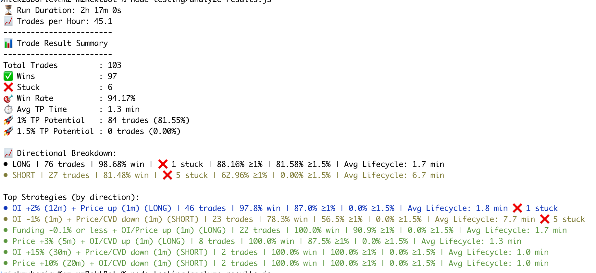

# Experimental Automated Trading Platform (Personal Sandbox)

This repository contains a personal, experimental MVP designed for deep, hands-on learning of real-time trading systems and rapid strategy prototyping. 

Initially built as an automated bot execution tool for Binance (trading off liquidations), it later evolved into a personal sandbox to automate manual trading approaches—specifically **DOLF analysis** (tracking **CVD, Open Interest, Liquidations, Funding Rates, and Long/Short ratios** via real-time WebSocket and API feeds).

> ⚠️ **Disclaimer:** This project was originally designed with a clean, decoupled architecture intended to support three different crypto exchanges simultaneously. However, as the focus shifted toward rapid strategy validation, the architecture chaoticly evolved into a Binance-only version. To move as fast as possible, standard design patterns were sacrificed, ultimately leading to anti-patterns—such as coupling all Binance WebSockets and REST API connections into a single, massive, monolithic class. It serves purely as a learning sandbox and a monument to rapid hypothesis testing. ¯\_(ツ)_/¯

## 🛠 Core Learning & Technology Focus
* **High-Throughput Exchange Integrations:** Real-time data streaming using Binance WebSockets (WSS) and REST APIs.
* **Event-Driven & Async Architecture:** Handling high-frequency market updates asynchronously in Node.js.
* **Order Execution Pipelines:** Managing complex order lifecycles, execution flows, and state synchronization.
* **Chat-Ops Interface:** Full control over configuration, settings, and instant alerts via a dedicated Telegram bot.
* **Data Analytics:** Implements post-trade analysis scripts to evaluate strategy performance and identify optimization areas.

## 🚀 Prerequisites & Environment
* **Runtime:** Node.js `v20.10.0` (Stably tested)
* **API Dependencies:** Binance API keys, Telegram Bot Token

## ⚙️ Installation & Setup

1. **Install dependencies:**
   ```bash
   npm install
   ```

2. **Configure Environment & Settings:**
   * Update the `config.json` file with your specific trading parameters.
   * Set up your system environment variables (e.g., Binance API keys, Telegram tokens).

3. **Start the Application:**
   ```bash
   npm start
   ```

## 📊 Analytics
The project includes specialized tooling to analyze test results, review trade performance, and uncover potential improvements for the trading engine.

To run the results analysis script, execute:
```bash
node testing/analyze-results.js
```

